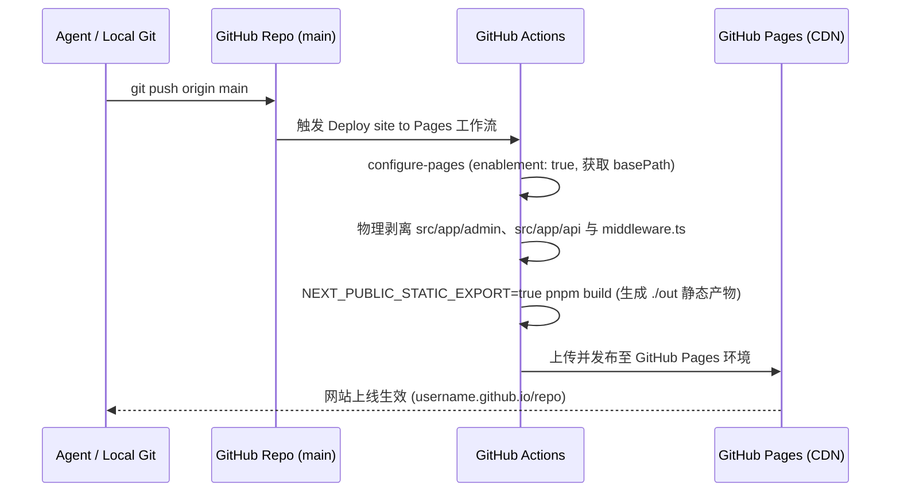

# AGENTS.md - 摄影作品集系统 Agent 自动化运维与管理规范

本文档为 AI Agent（以及协同开发者）提供完整的作品集管理、增删改查、版本控制、自动化部署与维护回退指南。请在接手或执行任何相关任务前完整阅读本规范。

---

## 1. 系统架构与核心技术栈

- **框架与运行时**：Next.js 14（App Router 架构）、React 18、TypeScript、Tailwind CSS。
- **3D 视觉与地图引擎**：Three.js、`@react-three/fiber`、`react-globe.gl`、D3-Geo、TopoJSON（大中华区 2.5D 微倾角立体线框球体地图）。
- **图片编解码与元数据**：
  - `sharp`：高质量等比缩放并压制为现代 WebP 格式（最大单边边长 $\le 2048\text{px}$）。
  - `exifr`：精准解析相机型号、镜头、曝光时间（快门）、光圈、ISO、原始拍摄时间（`DateTimeOriginal` / `CreateDate`）及 GPS 经纬度。
- **数据持久化中心**：
  - 单一真相源：[`src/data/portfolio-data.json`](file:///d:/Project/photos/src/data/portfolio-data.json)（相册、照片列表、专题归档）。
  - 站点品牌配置：[`src/data/site-config.json`](file:///d:/Project/photos/src/data/site-config.json)（作者姓名、Bio 简介、社交链接）。
  - 地理边界数据：[`src/data/china-geo.json`](file:///d:/Project/photos/src/data/china-geo.json)（大中华区矢量省界与坐标体系）。
- **静态资源存储**：
  - 转码后的 WebP 存放于 `public/photos/<年份>/<文件名>.webp`。

---

## 2. 核心业务铁律 (Core Invariants)

在进行任何自动化操作或代码修改时，**Agent 必须无条件遵守以下 4 条核心铁律**：

1. **拍摄时间绝对降序 (Shooting Date Descending)**：
   - **严禁**使用文件修改时间（`ModifyDate`）或上传时间进行排序！
   - 必须基于相机原始拍摄时间戳（`DateTimeOriginal` 或 `CreateDate`），在数据层与 API 呈现层均强制保持**从晚到早（降序）**排列，保证摄影师最新作品展示于页面最顶端。
   - 时间戳统一记录在 `photo.exif.dateTaken`，格式为完整 ISO-8601 UTC 字符串（如 `2026-07-18T12:51:22.000Z`）。
2. **严禁原始大图直接进库**：
   - 所有外部输入的相机 RAW/JPG/PNG 必须先经过 Sharp 转码为 WebP（尺寸 $\le 2048\text{px}$，quality 88，effort 4），严禁直接复制数十兆的未压缩图片。
3. **数据一致性校验**：
   - `albums` 和 `folders` 的 `order` 字段必须为从 `1` 开始递增的连续正整数。
   - 相册名、文件夹名需与 `albumPhotos` 和 `folderPhotos` 的键名完全匹配（区分大小写，如 `Guangzhou`、`Shenzhen`、`Cosplay`、`Street`）。
4. **验证门禁 (Zero Errors Gate)**：
   - 任何提交前必须执行并通过 `pnpm check`（TypeScript 零错误）和 `pnpm lint`（ESLint 零警告）。

---

## 3. 摄影作品与分类的 CRUD 操作指南

### 3.1 新增照片与导入流程 (Create / Import)

当用户提供新的拍摄素材（例如存放于 `D:\Document\新照片\` 目录）时：

1. **编写或执行导入脚本**（参考项目内置工具模版）：
   ```javascript
   import fs from 'fs';
   import path from 'path';
   import sharp from 'sharp';
   import exifr from 'exifr';

   // 读取原图并提取 EXIF
   const parsed = await exifr.parse(buffer, { tiff: true, exif: true, gps: true });
   const dateTaken = parsed.DateTimeOriginal || parsed.CreateDate; // 必须提取原始拍摄时间
   const year = dateTaken ? new Date(dateTaken).getFullYear().toString() : '2026';

   // 转码压制为 WebP
   const destDir = path.join(process.cwd(), 'public', 'photos', year);
   fs.mkdirSync(destDir, { recursive: true });
   const destPath = path.join(destDir, `${filename}.webp`);
   await sharp(buffer)
     .rotate()
     .resize({ width: 2048, height: 2048, fit: 'inside', withoutEnlargement: true })
     .webp({ quality: 88, effort: 4 })
     .toFile(destPath);
   ```
2. **构造 Photo 对象并注入元数据**：
   ```typescript
   const newPhoto: Photo = {
     id: `${albumSlug}-${filename.toLowerCase()}`,
     title: filename,
     date: year,
     size: fileStat.size,
     url: `/photos/${year}/${filename}.webp`,
     width: metadata.width,
     height: metadata.height,
     tags: [albumTitle, 'Street', year],
     exif: {
       camera: `${parsed.Make || ''} ${parsed.Model || ''}`.trim(),
       lens: parsed.LensModel,
       focalLength: parsed.FocalLength ? `${Math.round(parsed.FocalLength)}mm` : undefined,
       aperture: parsed.FNumber ? `f/${parsed.FNumber}` : undefined,
       shutterSpeed: formatShutterSpeed(parsed.ExposureTime),
       iso: parsed.ISO,
       dateTaken: dateTaken.toISOString(), // 核心 ISO 时间戳
       lat: parsed.latitude,
       lng: parsed.longitude
     }
   };
   ```
3. **推入并执行全局重排**：
   - 将新照片推入对应 `albumPhotos[albumTitle]` 或 `folderPhotos[folderTitle]`。
   - 调用 `sortPhotosByTakenDateDesc()` 确保数组保持降序。
   - 写回 `src/data/portfolio-data.json`。

### 3.2 查询与检索照片 (Read / Query)

- **前台逻辑统一调用** [`src/lib/api/index.ts`](file:///d:/Project/photos/src/lib/api/index.ts)：
  - `getAlbums()`: 获取城市相册元数据列表（按 `order` 排序）。
  - `getAlbum(slugOrTitle)`: 获取特定城市相册详情及降序排列的照片列表。
  - `getFolders()` / `getFolder(slugOrName)`: 获取专题归档列表与降序排列的照片列表。
  - `getPhotos(tag)`: 根据标签（支持多维：城市、题材、年份等）反向检索相关照片，同样保证拍摄时间降序。

### 3.3 修改作品与分类分类 (Update)

- **修改相册属性 (Albums)**：
  - 文件：`src/data/portfolio-data.json` 下的 `albums` 数组。
  - 支持字段：`title`（标题）、`slug`（路由别名）、`province`（省份）、`color`（主题色）、`description`（描述）、`date`（年份范围）、`lat`/`lng`（3D 地图聚焦坐标点）、`locations`（子拍摄点列表）、`tags`（标签数组）。
- **修改专题归档 (Folders)**：
  - 文件：`src/data/portfolio-data.json` 下的 `folders` 数组。
  - 增减专题分类时，需在 `folderPhotos` 下同步新增或重命名对应 key 的数组。
- **调整排序权重**：
  - 城市相册的 `albums` 推荐根据该城市**最新一张照片的拍摄日期**进行排序，把最新去过的城市放在最前面（`order: 1`）。

### 3.4 删除照片或分类 (Delete)

1. 从 `portfolio-data.json` 中的 `albumPhotos[album]` 和 `folderPhotos[folder]` 中过滤剔除目标照片。
2. 检查该 WebP 图片是否不再被任何其他相册或专题引用。若无引用，物理删除 `public/photos/...` 下的对应 `.webp` 文件以保持仓库轻量。
3. 若删除的是整个相册或专题，同步移除 `albums` / `folders` 数组中的定义，并重新自增重编 `order`（1, 2, 3...）。

---

## 4. Git 版本管理规范

项目内置了本地双重版本流：管理后台 GUI 操作与终端 Agent 指令操作。

### 4.1 提交规范 (Commit Convention)

Agent 提交代码或内容时，必须遵循结构化语义提交信息（Angular / Conventional Commits）：

- `feat(photos): ...`：添加新城市相册、导入新摄影作品、调整排序策略。
- `content(profile): ...`：修改摄影师简介、网站标题或社交链接。
- `fix(map): ...`：修复 3D 地图、投影、坐标或移动动效异常。
- `style(admin): ...`：调整管理后台或前台界面的排版与样式。
- `chore: ...`：依赖更新、配置调整或构建流水线优化。

### 4.2 提交前检查清单 (Pre-commit Checklist)

在任何 `git commit` 操作前，依次在终端执行：
```powershell
pnpm check       # 确保 TypeScript 无编译错误
pnpm lint        # 确保 ESLint 规范无报错
git status       # 检查工作区变动文件，避免临时调试文件被误提交
```

---

## 5. 部署上线至 GitHub Pages 完整工作流

作品集支持作为纯静态网站（Static HTML / CSS / Client JS）全托管于 GitHub Pages。

### 5.1 部署架构与安全物理隔离说明

- **前台展示端（公网只读）**：纯静态导出（SSG，`output: 'export'`），零服务器成本，借助 GitHub 全球 CDN 极速分发。
- **管理后台端（仅限本机）**：`/admin` 与 `/api/admin/*` 仅在摄影师本机（`pnpm dev`）运行。
- **CI 构建物理剥离（核心安全设计）**：
  - 在 GitHub Actions 构建静态产物前，流水线会自动执行 `rm -rf src/app/admin src/app/api src/middleware.ts`，并在 `About` 页面自动隐藏 `Studio` 入口链接。
  - 这意味着部署到 GitHub Pages 的静态产物中**物理上根本不存在 `/admin` 页面与后端接口**（访问 `/admin` 直接返回 `404`），且静态托管环境无任何 Node.js 写入进程，游客 **100% 不可能登录或篡改任何页面数据**。

### 5.2 自动化 CI/CD 流水线 ([`.github/workflows/nextjs.yaml`](file:///d:/Project/photos/.github/workflows/nextjs.yaml))

项目已预置 GitHub Actions 自动化工作流。当推送到 `main` 分支时自动触发：



### 5.3 首次仓库配置要求（必读：解决 `Get Pages site failed` 报错）

首次创建新仓库并推送时，若 GitHub 尚未初始化 Pages 环境，`actions/configure-pages@v5` 会报错 `HttpError: Not Found - Get Pages site failed`（且内置 `GITHUB_TOKEN` 无权调用 `createPagesSite`）。Agent 可直接通过本机已授权的 Git Credential 调用 GitHub REST API 自动开启 Pages（无需用户手动去网页设置）：

1. **Agent 终端一键开启 GitHub Pages（推荐）**：
   ```powershell
   $cred = "protocol=https`nhost=github.com`n`n" | git credential fill
   $token = ($cred | Select-String "^password=(.+)$").Matches.Groups[1].Value
   Invoke-RestMethod -Uri "https://api.github.com/repos/<Owner>/<Repo>/pages" -Method Post `
     -Headers @{ Authorization = "Bearer $token"; Accept = "application/vnd.github+json"; "X-GitHub-Api-Version" = "2022-11-28" } `
     -Body '{"build_type":"workflow"}' -ContentType "application/json"
   ```
   *(若用户偏好网页操作，也可打开仓库 **Settings** $\to$ **Pages** $\to$ **Source** 切换为 **`GitHub Actions`**)*。
2. **二级路径 (Subpath) 自动适配**：
   - 无论部署在根域名（`https://<username>.github.io`）还是项目二级路径（如 `https://tfiyuenlau.github.io/Photography-Portfolio`），流水线会自动将 `steps.pages.outputs.base_path` 注入 `NEXT_PUBLIC_BASE_PATH`。
   - [`next.config.mjs`](file:///d:/Project/photos/next.config.mjs)、[`src/lib/api/index.ts`](file:///d:/Project/photos/src/lib/api/index.ts)（图片路径前缀）与 [`src/app/folders/layout.tsx`](file:///d:/Project/photos/src/app/folders/layout.tsx)（脚本路径前缀）均会自动适配二级路径。

### 5.4 手动发布 / 重新触发部署命令

```powershell
# 1. 验证类型与规范
pnpm check; pnpm lint

# 2. 提交所有数据与代码更改
git add -A
git commit -m "feat(photos): update portfolio content"

# 3. 推送至远程仓库自动触发 GitHub Actions 部署
git push origin main
```
> 若仅修改了仓库的 Settings $\to$ Pages 设置而无新代码提交，也可直接在 GitHub 仓库的 **Actions** 标签页中点击失败的工作流 $\to$ 右上角点击 **Re-run all jobs** 重新触发部署。

---

## 6. 后续维护、健康检查与版本回退

### 6.1 服务启动与冲突排查

- **启动本地服务**：
  ```powershell
  pnpm dev
  ```
  本地访问地址：`http://localhost:3000`。
- **Windows 下 `.next` 缓存锁问题**：
  - *现象*：运行 `pnpm build` 时若后台正运行 `pnpm dev`，偶现 `PageNotFoundError: Cannot find module for page...` 或 `EBUSY` 文件占用错误。
  - *解决办法*：先终止后台 `pnpm dev` 任务，执行 `Remove-Item -Recurse -Force .next` 清除缓存，再运行 `pnpm build`，构建成功后再拉起 `pnpm dev`。
- **公网临时调试（Cloudflare Tunnel）**：
  ```powershell
  cloudflared tunnel --protocol http2 --url http://localhost:3000
  ```
  使用 `--protocol http2` 规避局域网 UDP 限制，确保稳定穿透。

### 6.2 版本回退与故障恢复 (Rollback Procedures)

#### 情况 A：刚编辑了数据，尚未执行 Commit，需要彻底放弃修改
```powershell
# 放弃数据和代码修改，还原至上一个提交状态
git restore src/data/portfolio-data.json src/data/site-config.json
```

#### 情况 B：已经执行了 Commit，需要回退到上一版本
```powershell
# 1. 查看最近提交记录
git log --oneline -n 5

# 2. 安全回滚最新一次提交（保留之后的排查记录）
git revert HEAD --no-edit

# 3. 若需要硬回退至特定提交（如 1a44db1）
git reset --hard 1a44db1
```

#### 情况 C：排查并修复某张照片缺少拍摄时间
若某张导入的照片缺少 `DateTimeOriginal`（表现为被排到了最底端），Agent 可通过快速脚本推断其时间并补全：
```javascript
// 读取并更新特定照片的拍摄时间
const data = JSON.parse(fs.readFileSync('src/data/portfolio-data.json', 'utf8'));
const photo = data.albumPhotos['Ganzhou'].find(p => p.id === 'ganzhou-p1015433');
if (photo) {
  photo.exif.dateTaken = '2026-02-04T10:01:00.000Z'; // 补齐时间
}
// 重新执行全局排序并写回
```

---

## 7. 快速命令备忘录 (Agent Cheatsheet)

| 意图 | 推荐终端命令 / API |
| :--- | :--- |
| **启动开发服务器** | `pnpm dev` |
| **全量类型检查** | `pnpm check` (`tsc --noEmit`) |
| **代码规范检查** | `pnpm lint` |
| **生产环境全量构建** | `pnpm build` |
| **启动公网临时隧道** | `cloudflared tunnel --protocol http2 --url http://localhost:3000` |
| **清除构建缓存** | `Remove-Item -Recurse -Force .next` (PowerShell) |
| **快速查看最新 5 条提交** | `git log --oneline -n 5` |
| **强制重新按拍摄时间排序** | `node scripts/sort-photos-by-shooting-date.mjs` |
